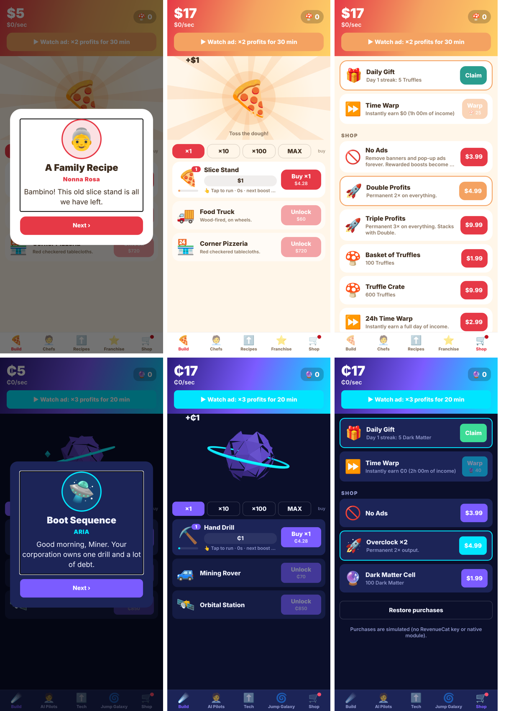

# Idle Tycoon Factory

One React Native codebase, many idle games. A game is a `games/<id>/game.json`
(plus optional art and sounds). The engine, UI, sound, ads, purchases and
analytics are shared, so a new game is a new folder and a new store listing.



Stack: Expo SDK 58 / React Native 0.88 · Skia · three.js on expo-gl (optional
3D scene) · Reanimated · zustand · AdMob (`react-native-google-mobile-ads`) ·
RevenueCat · Firebase Analytics, Crashlytics and Remote Config · zod-validated
config · vitest.

## Quick start

```bash
npm install
GAME=pizza-empire npx expo start     # or GAME=space-miner
GAME=pizza-empire npm run go         # Expo Go on your phone: scan the QR code
GAME=pizza-empire npm run go:fast    # the same without development mode: use this to judge speed
```

In Expo Go and on web, ads, purchases and Firebase are mocked (purchases succeed
at once so the flows can be tested). For real ads, IAP and analytics, make a
development build: `npx eas-cli@latest build --profile pizza-empire-dev --platform ios`.

## Modes

Three modes exist: `sim` (Pizza Empire), `haul` (Orbit Haulers, `games/space-miner`: drag drones
onto asteroids to set routes, money only when the freighter warps out; its own screen, rules, art and
sounds, specification `docs/design/space-design.md`) and `classic` (the original list game, kept for
new games made with `new-game`). The two list modes compare like this:

| | `"mode": "classic"` | `"mode": "sim"` (pizza-empire) |
|---|---|---|
| Businesses | a list; each pays straight into cash | **stations** of a production chain |
| Money | per business cycle | only when a guest **pays** at the end of the chain |
| Automation | one hire per business | one hire per station, plus one for transport (until then the player rings the bell) |
| Places | one | several **venues** (`sim.venues`), each a scaled copy of the chain |

**The production chain** (`sim`, schema in `src/config/schema.sim.ts`): stations
make goods → the **buffer** (`sim.buffer`, "The Pass") → **transport** workers
carry them (`sim.transport`: capacity per trip, a worker joins at each level in
`workersAt`) → guests at **seats** consume and pay (`sim.sales`: spend per guest,
`seatsAt`). Value flows as numbers and becomes cash only when a guest pays; that
is where global multipliers apply. Income is the slowest stage, and the UI names
it. The **rush** skill (`sim.rush`) runs the whole chain faster for a while. Each
stage has its own colour (`theme.colors.stages`) and is always shown with its
icon as well. Only the venue on screen is simulated actor by actor; the others
earn at their computed rate. Upgrades that target `"all"` are global income
multipliers in both modes.

A prestige reset (`economy.prestige`) starts the run again and keeps its points
(a permanent bonus each), everything bought with money and the meta progress.
`economy.milestoneRepeat` keeps levels meaningful past the last listed milestone.

## Meta: cards, chests, missions, deals, daily shop

All under `meta`, all optional, in both modes (space-miner has a small set,
pizza-empire the full one):

- **cards**: people with a rarity and one stat (`stationValue`, `transportCapacity`, `salesSpend`, `globalIncome`, `tapValue`, `offlineEarnings`, `bonusValue`, `rushDuration`; a classic game uses only the ones it has). Duplicates level a card up (`cardCopies`, `cardEffect`).
- **chests**: reward slots with odds that are shown to the player; `freeChest` (timer, stores up to `stored`), `adChest` (rewarded ad, per day), `pity` (bad-luck protection), mission `milestones`.
- **missions**: templates with `{n}` in the text; `earn` targets are seconds of income.
- **deals**: one-off bundles for money (a product of kind `deal`) or gems, with real end times of 48 h or more that never return. Deals are consumable: never `noAds` or a multiplier (those are their own products, so they can be restored).
- **dailyShop**: a few offers a day, one of them free.

**Chests are earned, not sold.** With `meta.chestsForSale: false` (the default)
no chest may have a gem price or sit in a deal or a daily offer, and gems buy
named cards and bundles with listed contents. Turning it on raises the age
rating (PEGI 16 in Europe; 16+ in Australia and 18+ in Brazil on the App Store),
switches chest sales off in `chestSalesBlockedIn` (BE, BR, NL by default) and
needs the random-items line on the listing (`npm run sync` adds it). `validate`
warns about it. Details: `docs/design/research/policy.md`.

## Characters

Characters are drawn in code (`src/ui/sim/art`, the sim mode's art: a game of
another mode does not bundle it and shows a placeholder for `char:` icons). Any
`icon` field takes an emoji, `"asset:<key>"` (an image listed in `assets`),
`"art:<name>"` (a drawn still, `src/config/artIcons.ts`) or `"char:<id>"`, a
person from the game's top-level `cast`:

```json
"cast": {
  "vega":   { "kind": "manager", "hair": "#1E1A2E", "hairStyle": "ponytail", "outfitStyle": "spacesuit", "hat": "helmet" },
  "kelvin": { "preset": "freeze", "hair": "#F2F2F2", "outfit": "#7FD1AE" }
},
"characters": [{ "id": "ai", "name": "ARIA", "portrait": "char:aria" }]
```

A look's fields are those of `CharacterLook` in `src/ui/sim/art/types.ts`
(kind, species, body, skin, hair, hat, outfit, glasses, ...). `preset` starts from
a built-in look in `src/ui/sim/art/looks.ts`; an unknown preset name gives a
random but stable person. Sim workers and guests use `workerLook`,
`sim.transport.looks` and `sim.sales.looks`, or generated looks when those are
empty. `validate` fails on a `char:` id missing from `cast`.

## Sound and haptics

Game code never plays a sound or vibrates directly: it calls the fx service
(`src/services/fx`, `fx.play('buy')`), whose catalogue (`catalog.ts`) pairs each
event with a sound and a haptic pattern, and respects the player's settings.

- Sounds come in packs, one folder each in `shared/sfx/<pack>/`. A game names its pack in game.json (`"soundPack": "warm"` for Pizza Empire; required, no default) and only that pack goes into its bundle; `"soundPack": null` means no shared pack (Orbit Haulers: every sound is its own, in `games/space-miner/assets/sfx/`, rendered by `scripts/audio/render_haul.py` and `haul_music.py`). A game overrides any sound with a file of the same name in `games/<id>/assets/sfx/` (`<key>.wav`, `<key>_1.wav` ..., music as `.m4a`). A missing sound is silent. `scripts/lib/games.js` merges the two into the bundle; run `npm run select` (or restart Expo) after adding a file.
- The catalogue is documentation and types only: the app plays from a table that `scripts/lib/games.js` writes into `src/generated/activeGame.ts` without the briefs and without the events of other modes (an entry with `modes: ['sim']` is for sim games only).
- Every sound is synthesised by `scripts/audio/` (Python 3 + numpy, ffmpeg for music):

```bash
python3 scripts/audio/make_sfx.py --check                                    # every catalogue key has a recipe
python3 scripts/audio/make_sfx.py --pack warm --out shared/sfx/warm          # the warm pack
python3 scripts/audio/render_haul.py                                         # Orbit Haulers' own sounds (docs/design/space-audio-notes.md)
python3 scripts/audio/compare.py space-miner pizza-empire                    # the two games must not sound alike (validate runs it)
python3 scripts/audio/qa.py shared/sfx/warm                                  # loudness and format checks
```

More in `docs/design/audio-notes.md` and `docs/design/fx-service-notes.md`.

## Making a game

| Way | Command |
|---|---|
| AI: Claude writes the skin (names, texts, icons, colours, characters, story, listing; in sim mode the stage and venue names); the numbers come from a balanced base | `npm run generate -- "haunted hotel" --base pizza-empire --org com.yourstudio` |
| Same, without the API (a synthetic skin, to test the path) | `npm run generate -- "haunted hotel" --base pizza-empire --dry-run --id _dry-test` |
| Clone and edit by hand | `npm run new-game -- candy-factory --name "Candy Factory" --from space-miner` |

Both work from a classic or a sim base. Both give the copied economy a seeded
variation of a few percent per row (`scripts/lib/vary.ts`), because `validate`
rejects two games with the same table or one a constant multiple of the other.
`generate` needs `ANTHROPIC_API_KEY` or an `ant auth login` profile. Folders
whose name starts with `_` are ignored by the app, `sync` and a plain
`validate`; delete test folders afterwards.

Then:

```bash
npm run validate -- candy-factory    # schema, cross checks, other games, policy warnings, 2 h bot run
npm run simulate -- candy-factory    # bot playthrough: unlock timeline, gaps, first prestige
npm run sync                         # eas.json, store listings, store/RATING-NOTES.md
```

Add `icon.png` (1024×1024), `adaptive-icon.png` and `splash.png` to the game
folder; without them the shared placeholders are used.

### What's in game.json

- **app**: display name, bundle id / package, version, EAS project id
- **theme**: colours (with `stages`), radius, `scene: "skia" | "three"`, hero icon, `displayFont`, `sceneBackground`, UI `icons`
- **strings**: currency, gem, prestige and tab names
- **economy**: milestones, prestige, offline cap, ad boost, daily gifts, time warp, `bonus`, `combo`
- **businesses / upgrades / characters / story**: the content; **sim**: chain, venues, rush (sim mode)
- **meta**, **cast**: see above
- **monetization**: AdMob ids, interstitial pacing, `maxAdContentRating`, RevenueCat keys, IAP products
- **firebase**: paths to `GoogleService-Info.plist` / `google-services.json`
- **store**: title, subtitle, keywords, descriptions, privacy policy URL

Custom art: put 1024 px transparent PNGs named by asset key in a folder, run
`python3 scripts/import-art.py <folder> <game-id>`, list each under `assets` and
use `"asset:<key>"`. Pizza Empire's art prompts are in `art/pizza-empire/prompts.py`.

## Balancing a new game

Each shipped game's numbers come from a script with documented formulas, so a
table is re-tuned in one place and is nobody else's:

```bash
npm run content:space                  # writes games/space-miner/game.json (haul; listing from scripts/content/space-store.json)
npm run content:pizza                  # writes games/pizza-empire/game.json (sim)
npm run simulate -- space-miner --hours 12
npm run simulate -- pizza-empire --hours 24 --prestige --quiet
npm run calibrate                      # pizza: searches venue opening costs for target times (slow, rewrites game.json)
```

`simulate` plays with a greedy bot that taps, restarts idle businesses, rings the
bell and buys the best payback (`--taps`, `--horizon`, `--trace 300`, `--json`
for scripts). Aim for: first automation within 2 to 3 minutes, a new unlock or
hire at least every 25 minutes in the first hours, the first prestige after a few
hours, and (sim) a second venue inside the first hour with transport and sales a
real but not dominant share of spending. Real players are slower than the bot by
about a quarter.

Orbit Haulers (haul): the targets are section 8 of `docs/design/space-design.md`
(first payout by 0:35, autopilot by 3:30, drags per 10 minutes gated); the numbers in
`build-space.py` are provisional until the balance pass reports them.

## Web preview switches

`GAME=pizza-empire npx expo start --web`, then add switches to the address
(`src/dev/devtools.web.ts`; the phone build takes `src/dev/devtools.ts`, which has none):

| | |
|---|---|
| `?preset=fresh\|early\|mid\|late` | start from a prepared state (bot play behind each, `src/dev/presets.ts`) |
| `&speed=10` | run the simulation faster (up to 200) |
| `&tab=home\|staff\|upgrades\|empire\|shop` | open a tab |
| `&modal=missions\|settings` | open a dialog |
| `&card=<cardId>`, `&odds=<chestId>`, `&chest=<chestId>`, `&deal=<dealId>` | card detail, chest odds, open a chest, a deal popup |
| `&story=1` | keep story dialogs (presets mark them seen) |

Example: `http://localhost:8081/?preset=mid&speed=10&tab=shop`.

## Layout

```
games/<id>/game.json     one folder per game (folders starting with _ are ignored)
games/<id>/assets/sfx/   the game's own sounds (override its pack by name)
shared/sfx/<pack>/       sound packs (warm: Pizza Empire; Orbit Haulers declares none); a game bundles only its own
games/<id>/store/        listing files (sync), fingerprint.json, releases.json, REVIEW-NOTES.md, bundle-report.json
src/engine/              pure TS economy, chain and meta + tests; no React, no native code, deterministic
src/config/schema*.ts    the GameConfig contract (zod); lint.ts: lintGameConfig (Node only)
src/services/            ads, iap, firebase, fx (sound + haptics); sdks.ts is the only place native SDKs load
src/state/store.ts       zustand store: every state change is an action here
src/ui/App.tsx           loading, the game loop, and the active mode's screen (src/generated/mode.ts)
src/modes/               mode entries (contract.ts; sim/, classic/, haul/): the only way in to mode code
src/ui/shell/TabShell    header, tabs, and every dialog and overlay of the sim and classic modes
src/ui/home/             the list homes' shared pieces (rows, station list, tutorial script)
src/ui/sim/              SIM MODE ONLY: home/ (stage strip and lists), scene/ (the living venue:
                         world/ draws it, play/ is what the player taps), art/ (characters, restaurant props)
src/ui/scene/            CLASSIC MODE ONLY: the hero scene (Skia, or three.js for a 3D game)
src/ui/haul/             HAUL MODE ONLY: the map, bay, sheets, spokes and the art kit (art/); rules in
                         src/engine/haul*.ts, src/engine/haul/, installed through src/engine/mode.ts
src/ui/art/              shared code-drawn pieces: chests, cards, coin, gem, tutorial hand, shared "art:" icons
src/ui/meta/             chests, cards, shop, deals, missions, settings, upgrades, empire
src/ui/hints/, juice/    the tutorial hand and its targets; coins and gems flying to the header
src/ui/kit/, theme.ts    shared dialog, list and text pieces; colours with readable-text helpers
src/dev/                 web preview switches and presets
scripts/                 generate, new-game, validate, simulate, sync, content/, audio/
```

`app.config.ts` writes `src/generated/activeGame.ts` and `src/generated/mode.ts`
so the bundle only contains the selected game (its JSON, images, sound pack and
fx events) and its own mode's code. `npm run check:bundle` proves it (fast; add
`--export` for the real bundler, run in a copy of the project, which writes
`games/<id>/store/bundle-report.json`); it also fails on another game's names and lines anywhere
in a bundle. How a mode is added: `docs/design/space-bundle.md`. On EAS, the
`eas-build-post-install` hook does the same from the `GAME` env of each profile.

## Before you publish

`npm run validate` must pass with no errors; read every warning. `npm run sync`
writes `games/<id>/store/RATING-NOTES.md`: the answers this config implies for
both stores' rating and data-safety forms. By hand, in the consoles (no tool
does these; sources in `docs/design/research/policy.md`):

1. **AdMob**: create the app and its banner, interstitial and rewarded units; paste them into `monetization.ads`; set `forceTestAds: false`; set the max ad content rating there to the same value as `maxAdContentRating`.
2. **Products**: create every id of `monetization.iap.products` in App Store Connect, Play Console and RevenueCat; paste the RevenueCat keys; turn on its Firebase integration.
3. **Firebase**: add the iOS and Android apps, drop the two files in the game folder, point `firebase` at them; link AdMob.
4. **EAS**: `GAME=<id> npx eas-cli@latest init`, copy the project id into `app.easProjectId`, `npm run sync`.
5. **Age rating**: answer both questionnaires (Advertising: yes; loot boxes: no unless chests are sold) and set Apple's rating to 13+ by hand; Play target audience 13+. Never the Kids Category or Designed for Families: the game has third-party ads and analytics.
6. **Listing**: a privacy policy URL (`store.privacyPolicyUrl`) that names AdMob, Firebase and RevenueCat; screenshots showing adult characters; no "kids" wording.
7. **Data safety / App Privacy**: from RATING-NOTES.md; check each SDK's current disclosure.
8. **App ids**: a real reverse domain in `app.iosBundleId` / `app.androidPackage` (Orbit Haulers still has `com.example.spaceminer`; `validate --release` fails on it).
9. **Two apps, one account** (`docs/design/research/spam.md`): `npm run check:bundle -- --export` for both games, the side-by-side check filled into `games/<id>/store/fingerprint.json` `human`, then `npm run validate:release` (every one of the 19 fingerprint dimensions known; 8 of 8 must). Paste `store/REVIEW-NOTES.md` into App Review's notes. The first submission of a game at least 14 days after the other's latest one.
10. Build and submit: `npx eas-cli@latest build --profile <id>-production`, run `npm run scan:binary -- <the .ipa or .aab> --game <id>` on it, then `submit --profile <id>-production`, and add the submission (with the scan report) to `store/releases.json`; push the iOS listing with `eas metadata:push` (the Play listing in `store/play/` uses the fastlane `supply` layout).

`npm run validate` fails when `games/<id>/store/*` is not what `npm run sync` would
write from game.json (a stale listing must never be uploaded), and when a store
text contains a banned word (real trademarks such as "Michelin", other studios'
names) or an "Idle ... Tycoon" title; the list is `BANNED_STORE_WORDS` in
`scripts/lib/checks.ts`.

**Web-only files in native exports.** `expo export` always copies `public/`
(including the 7.9 MB `canvaskit.wasm` the web preview needs) into its output
folder, for iOS and Android too. Nothing native reads it: EAS Build does not use
that folder, and `eas update` uploads only the files `metadata.json` lists. If you
ever upload an export by hand, upload only `metadata.json`, the bundles and the
assets it names.

**The spam rule, plainly.** Apple (4.3) and Google (Spam) both reject "multiple
apps with highly similar functionality, content, and user experience", and
Google can close every related account with the one it bans. Many games from one
codebase is exactly the pattern those rules describe, and neither store says how
different is enough. What helps: a different mode or meta mix per game, its own
economy (validate enforces this), its own art, characters, sounds and music, its
own listing text and screenshots (validate warns on near-identical
descriptions), never an "Idle <something> Tycoon" title, one account, one release
at a time, and time between releases. The safe fallback is one app with the
themes as worlds inside it.

## Live tuning, analytics, monetization

Remote Config parameters named after `REMOTE_KEYS` (`src/config/game.ts`)
override boost length and multiplier, offline cap, interstitial pacing and
global cost/revenue scaling without a release; use Firebase A/B Testing per
game. Every analytics event carries `game_id` and has the same name in every
game. Rewarded ads earn most of the money and are always opt-in, stating the
action and the exact reward; interstitials are rare and only at natural breaks.
Consent: Google UMP form, then ATT on iOS, then the SDK init.

## Commands

| | |
|---|---|
| `npm test` | engine and service tests (also validates every game.json) |
| `npm run typecheck` | TypeScript |
| `npm run lint:worklets` | checks that UI-thread animation code only calls UI-thread code (a mistake there crashes on phones, never in the web preview) |
| `npm run validate -- [<id>] [--no-sim]` | config errors, release warnings, the fingerprint of every pair of games and the sound similarity check |
| `npm run validate:release` | the same with every fingerprint dimension required (before a submission) |
| `npm run check:bundle` (`-- --export`, `-- --words`, `-- --list`) | what each game's app contains, and nothing of another game |
| `npm run scan:binary -- <file> --game <id>` | the same denylist and file hashes on a store binary |
| `npm run simulate -- <id>` | pacing report |
| `npm run content:space`, `content:pizza` | rebuild a shipped game's game.json from its script |
| `npm run calibrate` | pizza-empire venue costs for target times |
| `npm run sync` | eas.json, store listings, rating notes |
| `npm run new-game -- <id>` | clone a game, economy varied |
| `npm run generate -- "<theme>"` | AI-skinned game (`--dry-run` without the API) |
